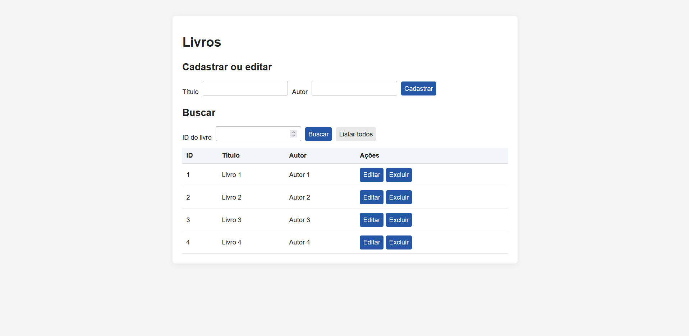
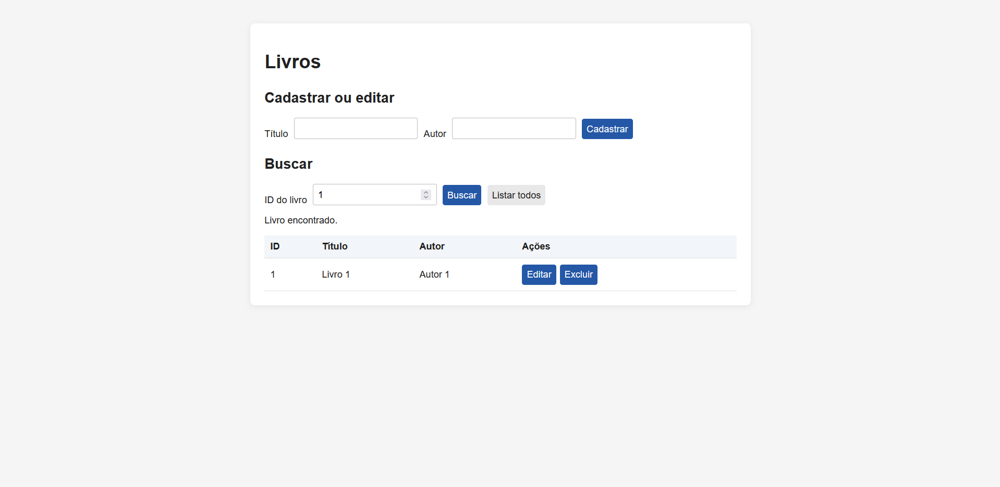

# Livros: Flask + MySQL + frontend

Projeto simples para cadastrar, listar, buscar, editar e excluir livros. A API é feita com Flask, os dados ficam no MySQL/MariaDB do XAMPP e a página usa HTML, CSS e JavaScript.

## Pré-requisitos

- Python 3 e `pip`.
- XAMPP com o módulo **MySQL** iniciado.
- Para importar os arquivos SQL pelo navegador, inicie também o **Apache** e abra `http://localhost/phpmyadmin/`.

## Screenshots




## Instalação

Na pasta principal do projeto, instale as dependências:

```bash
python -m pip install -r flask_api/requirements.txt
```

Use o mesmo `python` para instalar as dependências e executar a API. O arquivo `requirements.txt` contém Flask e PyMySQL.

## Banco de dados

No phpMyAdmin, importe os arquivos nesta ordem:

1. `flask_api/schema.sql` — cria o banco `flask_api` e a tabela `livros`.
2. `flask_api/seed.sql` — opcional; adiciona três livros de exemplo. Importe apenas uma vez em uma tabela vazia.

Cada livro tem `id`, `titulo` e `autor`. A conexão em `flask_api/app.py` usa `127.0.0.1`, usuário `root`, senha vazia e banco `flask_api`. Se seu MySQL tiver outra senha, altere o campo `password` nesse arquivo.

## Executar

Com o MySQL iniciado, rode na pasta principal:

```bash
python flask_api/app.py
```

Abra `http://localhost:5000/`. O Flask serve a página da pasta `web/` e as rotas da API na porta 5000.

## Rotas da API

URL base: `http://localhost:5000`.

| Método | Rota | O que faz |
| --- | --- | --- |
| GET | `/livros/listar` | Lista todos os livros. |
| GET | `/livros/buscar/<id>` | Busca um livro pelo ID. |
| POST | `/livros/cadastrar` | Cadastra um livro. |
| PUT | `/livros/atualizar/<id>` | Atualiza um livro. |
| DELETE | `/livros/excluir/<id>` | Exclui um livro. |

Substitua `<id>` por um número inteiro, por exemplo, `/livros/buscar/3`.

Para cadastrar ou atualizar, envie um JSON como este:

```json
{
  "titulo": "Meu livro",
  "autor": "Meu autor"
}
```

Cadastro, busca e exclusão retornam o livro correspondente. A atualização retorna apenas `titulo` e `autor`. Se o ID não existir, a API responde com erro 404.

## Arquivos

- `flask_api/app.py`: API e conexão com o banco.
- `flask_api/schema.sql` e `flask_api/seed.sql`: estrutura e exemplos do banco.
- `web/index.html`, `web/style.css` e `web/script.js`: página e chamadas à API.
- `docs/`: exportação do Insomnia para testar as rotas.
- `crud-exemple/teste.py`: exemplo anterior, separado da aplicação atual.
